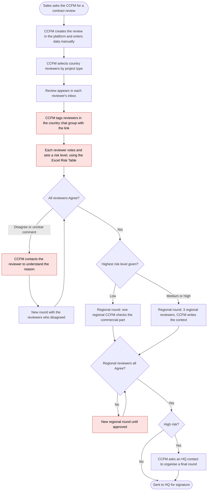
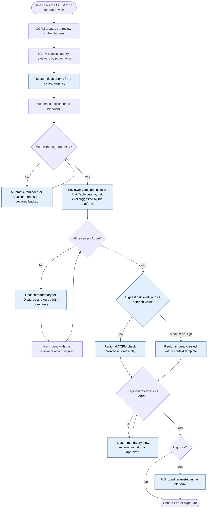

# 3. Process Maps

CCFM = Contract and Commercial Fulfilment Manager (regional level), owner of the workflow.

## As-is

Red steps are the pain points. A wrong or poorly justified risk level at step F sends the contract down the wrong path, or stalls it while the CCFM asks for clarification. There is no priority rule: contracts are handled in whatever order reviewers open them.

## To-be

Blue steps are the changes. What disappears: tagging in chat groups, chasing reviewers for their reasons, the separate Excel file, and risk levels justified only in free comments.

## Change summary

| Step | As-is | To-be |
|---|---|---|
| Ordering | No priority | Priority flag (risk and urgency) |
| Follow-up | CCFM tags reviewers in chat groups | Automatic reminder, then backup |
| Disagreement | Reason optional, CCFM chases it | Reason mandatory |
| Risk level | Set from an Excel file, justified in free comments | Set from Risk Table criteria in the platform |
| Routing by risk | CCFM reads the comments and opens the next round by hand | Next round created from the highest risk level |
| Regional and HQ rounds | Context written from scratch, HQ contacted by message | Context template, HQ request in the platform |
